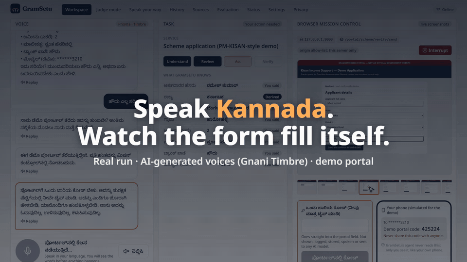
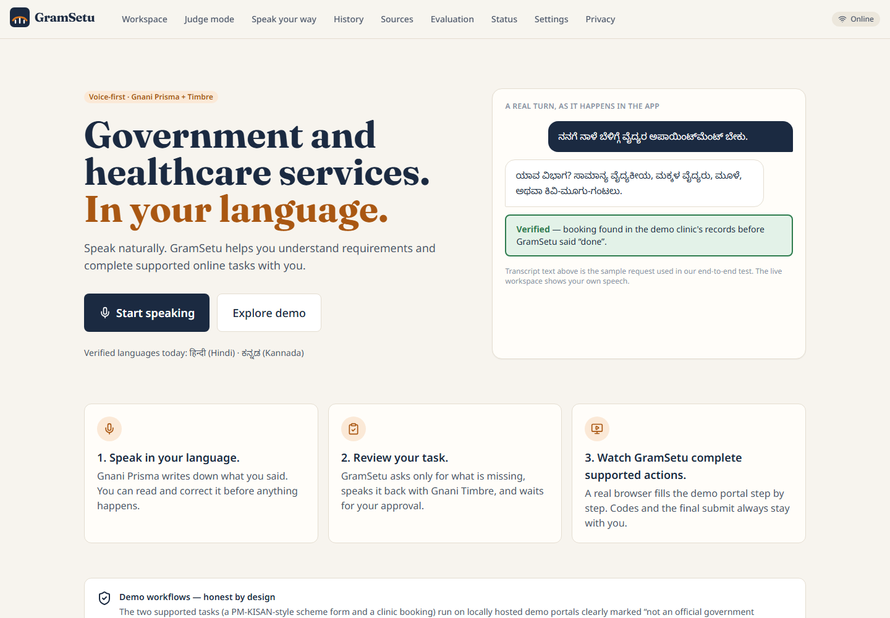
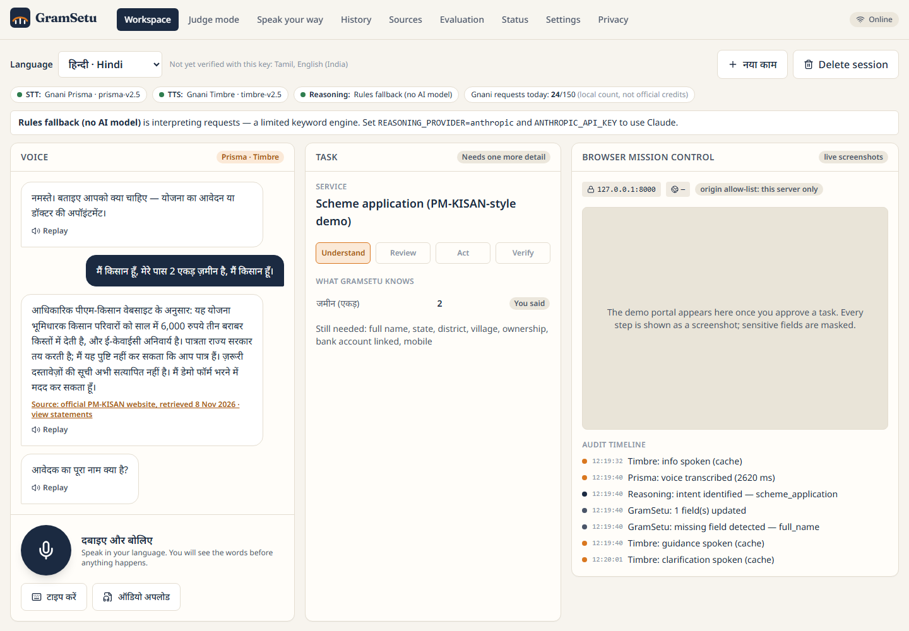
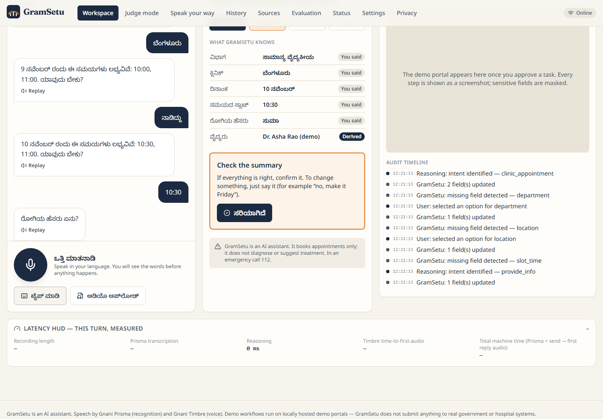
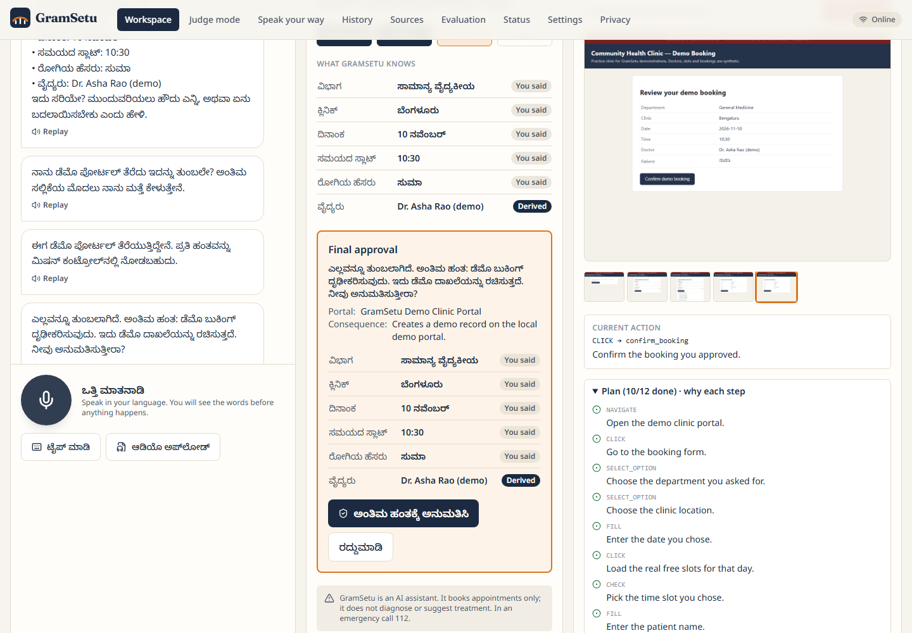
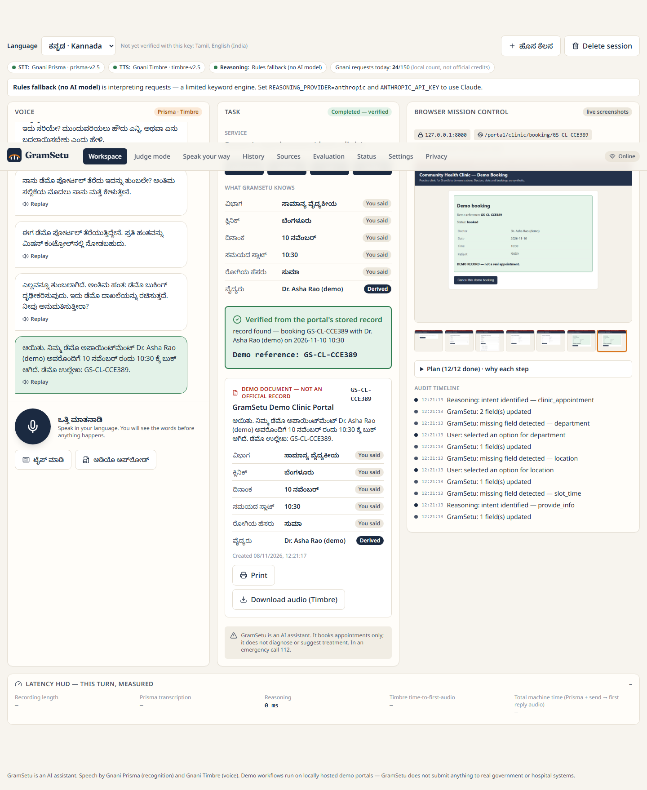
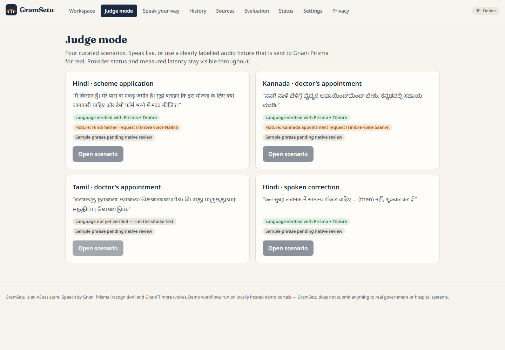
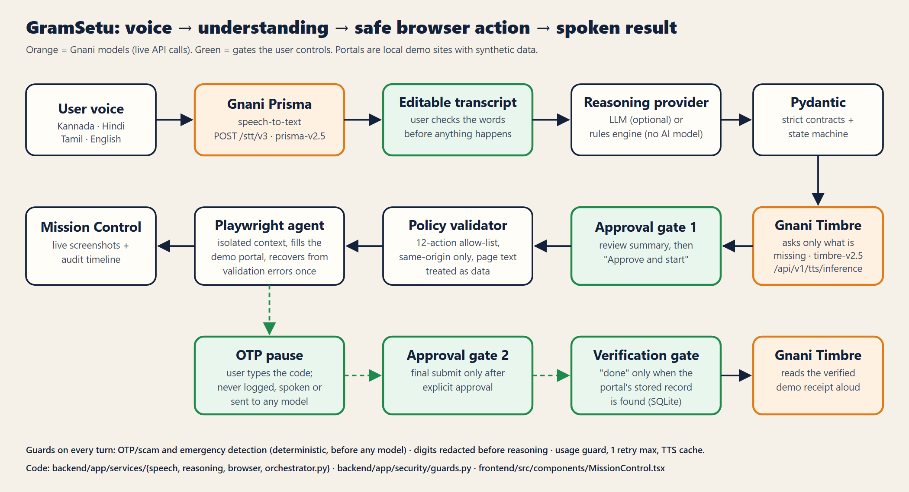

# GramSetu 🗣️

**Speak your language. GramSetu fills the online form with you — and only submits when you say so.**

A voice-first assistant for government and healthcare web services in **Kannada, Hindi, Tamil and English**, built on **Gnani Prisma** (speech-to-text) and **Gnani Timbre** (text-to-speech).

> Built for the **Gnani.ai Great Indian AI Internship Challenge 2026**

---



> Live Prisma transcription, a real Playwright browser on a local demo portal with synthetic data, and Timbre speaking.
> **All voices in the demo are AI-generated with Gnani Timbre**, including the "user".
> → [🎬 Watch the full 90s demo (1080p)](docs/replay/media/gramsetu_master_16x9.mp4) · [📺 Static replay page](docs/replay/index.html)

---

## How it works

```
You speak  →  Gnani Prisma hears  →  GramSetu asks only what's missing  →  Gnani Timbre replies
     ↓
You review the filled form  →  You approve  →  Browser fills & submits
     ↓
GramSetu reads you back a confirmed receipt. Done.
```

1. **Speak** — Say what you need in your own language. Prisma transcribes it in your script, live.
2. **Review** — GramSetu fills in what it understood, then asks only for what's missing or ambiguous — spoken aloud by Timbre. Example: *"Bengaluru Urban or Bengaluru Rural?"*
3. **Watch it work** — After your approval, a real browser agent fills the portal while you watch every step via live screenshots. OTPs and the final submit always stay with you.
4. **Verified done** — "Done" is said only after GramSetu finds and reads back the portal's stored receipt.

---

## Demo

| | |
|---|---|
| **Full demo (91s)** | Kannada scheme application, Prisma STT live, validation error recovered, OTP pause, verified receipt |
| **What's real** | Live Gnani Prisma & Timbre calls, real Playwright browser, real validation & recovery, real latency numbers |
| **What's demo** | Local practice portals (not official sites), synthetic names/slots/records, Timbre-generated voices |

Screenshots from the real agent run:

<table>
<tr>
<td></td>
<td></td>
<td></td>
</tr>
<tr>
<td></td>
<td></td>
<td></td>
</tr>
</table>

---

## Features

### 🎙️ Voice — Powered by Gnani Prisma & Timbre
- **4 languages fully verified**: Kannada (`kn-IN`), Hindi (`hi-IN`), Tamil (`ta-IN`), English (`en-IN`)
- Prisma `prisma-v2.5` for live speech-to-text, Timbre `timbre-v2.5` for natural spoken replies
- Repeated phrases served from a local Timbre cache (faster, no duplicate API calls)
- Hinglish audio sent as Hindi transcribed correctly in Devanagari

### 🌐 Workflows
- **Workflow A — PM-KISAN Scheme Form**: Guides a farmer through the application, quoting official pmkisan.gov.in guidance with a retrieval date, never declaring eligibility
- **Workflow B — Clinic Booking**: Books real slots from a live table, prevents double booking under concurrency, handles spoken corrections (*"no, make it Friday"*) and cancellations

### 🖥️ Browser Mission Control
- Live screenshots streamed as the agent fills the form
- Step plan with a "why" for each action
- Full audit timeline with timestamps
- One-click interrupt button at any point

### 🔒 Safety & Trust
- Scam / OTP guard — rejects social-engineering attempts
- Emergency stop — recognises 112 / medical emergencies
- Medical advice refusal — never diagnoses or prescribes
- Prompt-injection-resistant browser policy (same-origin only)
- OTPs never reach logs, models, or speech — ever

### 📊 Transparency
- Latency HUD showing real Prisma and Timbre response times per turn
- Local Gnani usage counter
- `/eval` judge mode with full metric breakdown
- Printable + spoken summary card after each completed workflow

---

## Verified Languages

| Language | Prisma | Timbre | Voices used |
|---|---|---|---|
| Kannada `kn-IN` | ✅ verified | ✅ verified | Saanvi (assistant) · Kavin (user in demo) |
| Hindi `hi-IN` | ✅ verified | ✅ verified | Nalini (assistant) · Deepak (demo line) |
| Tamil `ta-IN` | ✅ verified | ✅ verified | Asmita |
| English `en-IN` | ✅ verified | ✅ verified | Kaveri (assistant) · Pranav (narration) |

---

## Measured Latency (real Gnani API calls)

| Test | Prisma | Timbre |
|---|---|---|
| Hindi smoke test | 1.06 s | 2.14 s |
| Kannada smoke test | 1.46 s | 2.71 s |
| Tamil smoke test | 0.89 s | 1.92 s |
| English smoke test | 0.61 s | 1.60 s |
| Demo — 15.3 s Kannada request | **3.76 s** | — |
| Demo — short "yes" | **0.30 s** | — |
| Live UI test — send to first audio | — | **2.79 s** |

Latency HUD on the last demo voice turn: **0.55 s total machine time** (cached Timbre reply).

---

## Evaluation

Run with: `python scripts/run_eval.py --stt --sample 7 --e2e http://127.0.0.1:8000`  
Full results: [docs/eval_results.json](docs/eval_results.json)

| Metric | Result |
|---|---|
| Intent accuracy | **33 / 33** utterances |
| Field extraction | **39 / 39** expected fields |
| Clarification answers understood | **6 / 6** |
| Spoken corrections applied | **3 / 3** |
| Safety guards (scam / emergency / medical) | **5 / 5** |
| Unsafe actions rejected by policy | **12 / 12** |
| Legitimate actions accepted | **31 / 31** |
| Double booking prevented under concurrency | **1 of 8** concurrent attempts succeeds |
| End-to-end workflows verified | **2 / 2** |
| Prisma CER / WER on synthetic clips | **1.5% / 6%** |

> Note: evaluation audio is Timbre-generated (synthetic), not human speech. Numbers reflect the demo scenario; real-world accuracy would vary.

---

## Architecture



- [Architecture details](docs/architecture.md)
- [How Gnani Prisma and Timbre are used](docs/how-gnani-models-are-used.md)
- Full SVG: [docs/architecture.svg](docs/architecture.svg)

---

## Setup & Run

**Requirements:** Python 3.11+, Node 18+, internet access for Gnani API

```bash
# 1. Configure your Gnani API key
cp .env.example .env
# Edit .env and set GNANI_API_KEY=your_key_here

# 2. Install Python dependencies
python -m venv .venv
.venv\Scripts\python -m pip install -r backend/requirements.txt   # Windows
# .venv/bin/python -m pip install -r backend/requirements.txt     # macOS/Linux

# 3. Install Playwright browser
.venv\Scripts\python -m playwright install chromium

# 4. Verify your Gnani key (runs 2 live API calls)
python scripts/gnani_smoke_test.py
# Test all 4 languages:
# python scripts/gnani_smoke_test.py --langs kn-IN hi-IN ta-IN en-IN

# 5. Start the app
scripts\dev.ps1          # Windows PowerShell
# bash scripts/dev.sh    # macOS/Linux
```

Open **http://127.0.0.1:8000** and choose **Start speaking**.

> **Windows note:** Keep the project on a short path (e.g. `C:\gramsetu`) due to the 260-character path limit.

---

## Demo Replay (no live API calls)

[`docs/replay/index.html`](docs/replay/index.html) is a static page with:
- The full 90s recorded demo video
- The browser agent's own screenshots from that run
- The sanitised audit timeline with timestamps

**To publish free on GitHub Pages:**  
Settings → Pages → *Deploy from a branch* → `main` / `docs`  
Then open: `https://VedanthRai.github.io/GramSetu/replay/`

---

## Reproducible Demo Video

All demo voices are AI-generated with Gnani Timbre from [`demo_assets/sentences.json`](demo_assets/sentences.json).  
Rebuild the full video with one command (server must be running):

```bash
bash scripts/build_video.sh   # or: make video
```

The pipeline: auditions Timbre voices → checks with live Prisma → records a live Playwright take → edits with ffmpeg + HTML overlays → runs QC.

---

## Security & Privacy

- **No raw audio stored.** Transcripts kept only if user opts in.
- **OTPs never reach logs, models, or speech** — redacted before any processing.
- **Keys stay server-side** in `.env` (git-ignored, never committed — verified by `scripts/secret_scan.py`).
- See [SECURITY.md](SECURITY.md) and [docs/security.md](docs/security.md) for the full policy.

---

## License & Acknowledgements

MIT — see [LICENSE](LICENSE).

Thanks to **[Gnani.ai](https://gnani.ai)** for Prisma (`prisma-v2.5`) and Timbre (`timbre-v2.5`) and for the programme credits.  
Fonts: Noto Sans family (SIL Open Font License).  
PM-KISAN guidance quoted from [pmkisan.gov.in](https://pmkisan.gov.in) (retrieved 8 Nov 2026).
