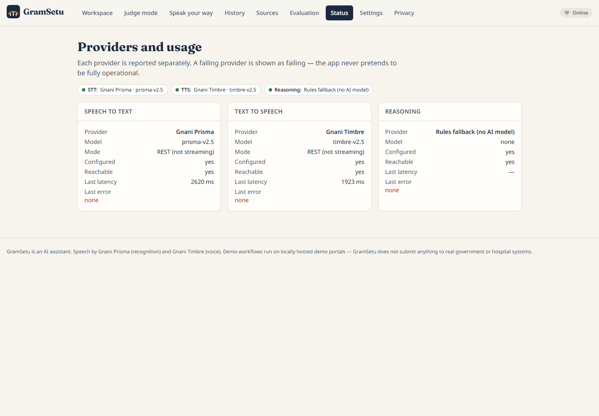

<div align="center">

# GramSetu

### Speak your language. GramSetu fills the online form with you, and submits only when you say so.

A voice-first agent for government and healthcare web services in **Kannada, Hindi, Tamil and English**,
built on **Gnani Prisma** and **Gnani Timbre**.


**[▶ Watch the 3-minute demo](docs/media/GramSetu_demo.mp4)** &nbsp;·&nbsp; **[📄 One-page solution pitch](Solution_Pitch.pdf)** &nbsp;·&nbsp; **[🚀 Run it yourself](#quick-start)**


</div>

## The problem

A farmer applying for a support scheme, or a patient booking a clinic visit, can explain exactly what they need out loud.
What stops them is the screen: English-first forms, field after field, where one small mistake means starting again.

**GramSetu ("bridge to the village") lets them simply say it.** It writes down what it heard, asks only about what is
missing, and fills the form in front of them, with the person in control of every step that matters.

## How it works

| | Step | What happens |
|:---:|---|---|
| 🎙️ | **Speak** | Say what you need. Gnani Prisma writes it down in your own script, and you can check the words. |
| 💬 | **Review** | GramSetu fills in what it understood and asks aloud, with Gnani Timbre, only for what is missing: *"Bengaluru Urban or Bengaluru Rural?"* It then reads back a summary. |
| 🌐 | **Watch it work** | After you approve, a browser agent fills the portal while you watch every screenshot. It pauses for your one-time code and asks again before the final submit. |
| ✅ | **Verified** | GramSetu says "done" only after it finds the portal's stored record, then reads the receipt aloud. |

The workflows run on two built-in practice portals with sample data, clearly marked as not official government websites.


## How Gnani powers GramSetu

| Model | Role in the product | API |
|---|---|---|
| **Gnani Prisma** `prisma-v2.5` | Transcribes every voice turn in the user's language and script | `POST /stt/v3` |
| **Gnani Timbre** `timbre-v2.5` | Speaks every question, summary, progress update and receipt | `POST /api/v1/tts/inference` |

Requests are serialised, repeated phrases are cached, and a local usage guard limits daily calls. Every voice turn shows its
measured latency on screen. Full details are in [how the Gnani models are used](docs/how-gnani-models-are-used.md).

| Language | Code | Prisma | Timbre | Exercised through |
|---|---|:---:|:---:|---|
| Kannada | `kn-IN` | ✅ | ✅ | Scheme application and clinic booking, end to end |
| Hindi | `hi-IN` | ✅ | ✅ | Scheme application and clinic booking, end to end |
| Tamil | `ta-IN` | ✅ | ✅ | Live speech checks and evaluation sentences |
| English | `en-IN` | ✅ | ✅ | Live speech checks and evaluation sentences |

## Features

- **Two complete workflows:** a PM-KISAN-style scheme application, and clinic booking from a real slot table with spoken corrections ("no, make it Friday") and cancellation.
- **Browser Mission Control:** live screenshots, a plan with a "why" for every step, an audit timeline and an interrupt button.
- **Self-correcting agent:** reads the portal's own validation message and fixes the field, for example "2" to "2.00".
- **Two approval gates:** nothing is typed before you approve, and the final submit needs a second, explicit yes.
- **Trusted guidance:** scheme information is quoted from pmkisan.gov.in with its retrieval date.
- **Safety guards:** scam and OTP detection, emergency stop (112), medical-advice refusal, and same-origin browsing.
- **Accessible by design:** voice-only mode, printable and spoken summary card, judge mode and task history.

## Screenshots

| Home | Final approval |
|---|---|
|  |  |

| Judge mode | Provider status |
|---|---|
|  |  |

## Quick start

You need Python 3.11+, Node 18+ and a [Gnani](https://app.gnani.ai) API key.

**macOS or Linux**

```bash
git clone <your-repo-url> gramsetu && cd gramsetu
cp .env.example .env                                  # then set GNANI_API_KEY in .env
python3 -m venv .venv
.venv/bin/python -m pip install -r backend/requirements.txt
.venv/bin/python -m playwright install chromium
.venv/bin/python scripts/gnani_smoke_test.py          # checks your key with 2 Gnani calls
scripts/dev.sh
```

**Windows PowerShell** (keep the project on a short path such as `C:\gramsetu`)

```powershell
git clone <your-repo-url> gramsetu; cd gramsetu
copy .env.example .env                                # then set GNANI_API_KEY in .env
python -m venv .venv
.venv\Scripts\python -m pip install -r backend\requirements.txt
.venv\Scripts\python -m playwright install chromium
.venv\Scripts\python scripts\gnani_smoke_test.py      # checks your key with 2 Gnani calls
scripts\dev.ps1
```

Open <http://127.0.0.1:8000> and choose **Start speaking**.

No key yet? Set `GNANI_FIXTURE_MODE=true` in `.env` to explore the interface with recorded responses.

## Results

| Metric | Result |
|---|---|
| Intent accuracy | **33 / 33** utterances |
| Field extraction | **39 / 39** expected fields |
| Clarification answers and spoken corrections | **6 / 6** and **3 / 3** |
| Safety guards (scam, emergency, medical) | **5 / 5** |
| Unsafe actions rejected by policy | **12 / 12** |
| Legitimate actions accepted | **31 / 31** |
| Double booking | Exactly **1 of 8** concurrent attempts succeeds |
| End-to-end workflows verified | **2 / 2** |
| Prisma character error rate | **1.5%** on 6 clips |

Measured on the project's own test set with synthetic audio, using the built-in deterministic understanding engine. Raw
results are in [docs/eval_results.json](docs/eval_results.json).

```bash
cd backend && python -m pytest -q      # 60 tests, no API key needed
cd frontend && npm test                # 7 tests
python scripts/run_eval.py             # evaluation set
```

## Security and privacy

- API keys stay server-side in `.env`, which is git-ignored.
- Raw audio is not stored, and transcripts are kept only if you opt in.
- One-time codes go from your hand to the portal field, and never reach logs, models or speech.
- The browser agent runs a 12-action allow-list on a single origin, and page text is treated as data, never as instructions.

See [SECURITY.md](SECURITY.md) and the [security design](docs/security.md).

## Project structure

```text
backend/app/
  api/            REST and WebSocket routes
  services/       speech (Gnani), reasoning, browser agent, appointments, schemes, verification
  portals/        Adapter framework for adding services
  demo_portals/   Practice portals: scheme form and clinic
  security/       OTP, scam and emergency guards
frontend/src/     React and TypeScript UI, microphone capture
docs/             Architecture, Gnani integration, security, evaluation results
scripts/          Dev server, smoke test, evaluation and end-to-end runs
```

Further reading: [architecture](docs/architecture.md) · [model setup](docs/model-setup.md)

## License

Released under the [MIT License](LICENSE). Thanks to **Gnani.ai** for Prisma and Timbre.
