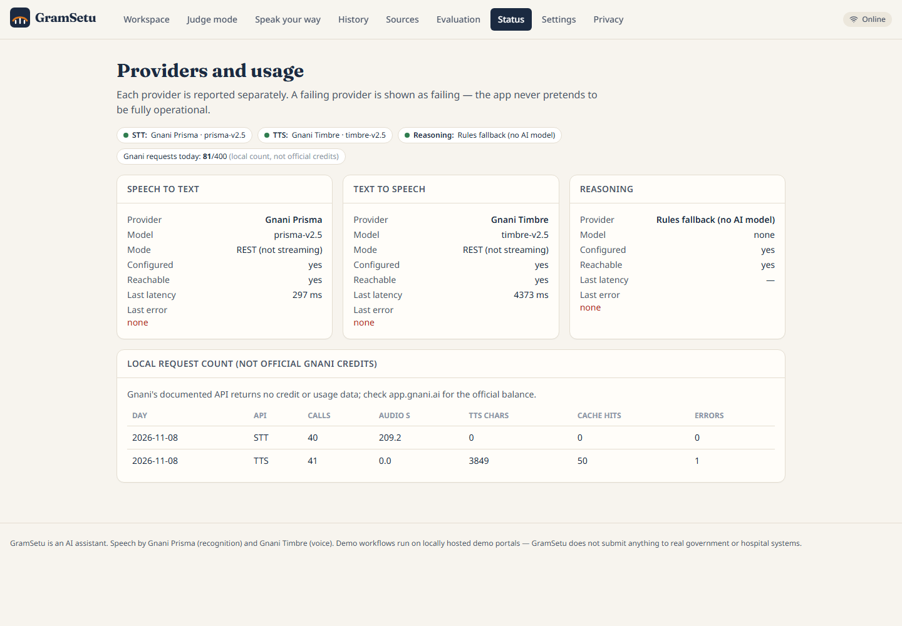

# Evidence of Gnani model usage

## APIs, versions, languages and voices

| | Gnani Prisma (speech-to-text) | Gnani Timbre (text-to-speech) |
|---|---|---|
| Endpoint | `POST https://api.vachana.ai/stt/v3` | `POST https://api.vachana.ai/api/v1/tts/inference` |
| Version | `prisma-v2.5` (reported in every response) | `timbre-v2.5` |
| Languages verified with our key | kn-IN, hi-IN, ta-IN, en-IN | kn-IN, hi-IN, ta-IN, en-IN |
| Voices used | not applicable | Saanvi (kn), Kavin (kn, demo user voice), Nalini (hi), Deepak (hi, demo line), Asmita (ta), Kaveri (en), Pranav (en, narration) |
| Code | `backend/app/services/speech/gnani.py` | same file |

Full details: [docs/how-gnani-models-are-used.md](../how-gnani-models-are-used.md). Capability table:
`backend/app/services/speech/verified_capabilities.json`; raw smoke-test output: `docs/smoke_test_result.json`.

## Measured latency

| Source | Prisma | Timbre |
|---|---|---|
| Smoke test, Hindi (latest run, 8 Nov 2026) | 1.06 s | 2.14 s |
| Smoke test, Kannada | 1.46 s | 2.71 s |
| Smoke test, Tamil | 0.89 s | 1.92 s |
| Smoke test, English | 0.61 s | 1.60 s |
| Demo take 1 (through the app): 15.3 s Kannada request / short answer / "yes" | 3,764 / 2,707 / 297 ms | receipt (live, not cached): 4,373 ms server time |
| Latency HUD, last voice turn of the demo take | 297 ms | 89 ms to first audio (cached phrase); total machine time 0.55 s |
| Earlier live UI voice test | | 2.79 s from send to first reply audio |

## Local request counts (NOT official Gnani credits)

Gnani's API returns no credit or balance data. These are GramSetu's own counts (`/status` page, `usage` table):

| Day | API | Calls | Audio seconds | TTS characters | Cache hits | Errors |
|---|---|---|---|---|---|---|
| 2026-11-08 | Prisma (STT) | 40 | 209.2 | — | — | 0 |
| 2026-11-08 | Timbre (TTS) | 41 | — | 3,849 | 50 | 1 (a 502 during a rehearsal) |

Plus 11 smoke-test calls made by `scripts/gnani_smoke_test.py` outside the app counter. Official balance: app.gnani.ai.

## Screenshots

* Provider status page (live, reachable, model versions, local counts): 
* A live Prisma transcript in the app (Kannada): see `demo-output/final/thumbnail_1080x1350.png` and the master video at about 0:25.
